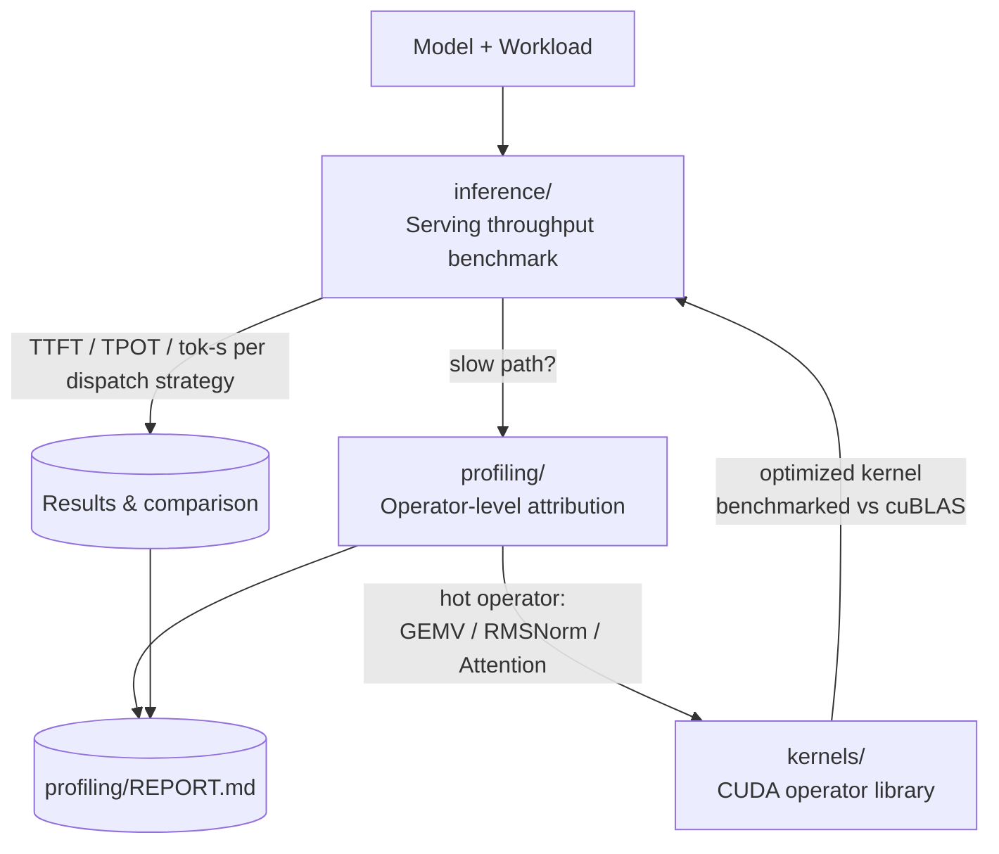

# AI-infra

An open, reproducible toolkit for **measuring, attributing, and reducing the inference cost of transformer language models on commodity GPUs** — spanning end-to-end serving latency down to the individual CUDA operator.

Production LLM serving is governed by two questions that this repository answers with hard numbers rather than intuition:

1. **What can we commit to?** End-to-end latency (TTFT / TPOT) and throughput (tok/s) under realistic workloads and dispatch strategies.
2. **Where does the wall-clock go?** Operator-level attribution of the hot path, and whether the bottleneck is compute-, bandwidth-, or dispatch-bound.
3. **Can we close the gap?** Hand-written CUDA operators for the exact kernels the profiler flags, benchmarked against vendor libraries.

The three subsystems are independent, composable, and share one model/load contract so that a number measured at the top (serving) can always be traced down to a specific operator at the bottom.



## Subsystems

### `inference/` — Serving throughput benchmark
Measures the metrics a serving SLA is built on (Time-To-First-Token, Time-Per-Output-Token, tokens/sec) across four dispatch strategies on the **same** model and workload:

| Method | Strategy | Notes |
|---|---|---|
| `bench_1` | Eager (vanilla `torch`) | Baseline, no graph capture |
| `bench_2` | `torch.compile` (cudagraphs on Pascal, inductor elsewhere) | Static-graph dispatch |
| `bench_3` | vLLM | Continuous batching, paged KV-cache |
| `bench_4` | SGLang (incl. TRT-LLM path) | Kernel-level fused serving stack |

Workloads are fixed and reproducible: **A** (chat-like, in=128/out=128) and **B** (long-prefill, in=512/out=32), each at batch 1 and 4. Output is a per-cell JSON plus a comparison harness (`compare.py`, `compare_baseline.py`). See [`inference/README.md`](inference/README.md).

### `profiling/` — Operator-level attribution
A PyTorch Profiler pipeline that collects **prefill and decode separately** (they are bound by different resources and must not be averaged together) and emits, per variant:

- a `key_averages` table (`results/*.table.txt`) sorted by self-CUDA time,
- a chrome/Perfetto trace (`results/*.trace.json`) where the eager "saw-tooth" vs cudagraphs "solid block" is visible by eye,
- four derived metrics — kernels/step, mean kernel time, GPU busy ratio, and memcpy/memset volume — plus a JSON roll-up (`results/prof_metrics.json`).

A second path (`prof_2_ncu_kernels.py` + `nsys_commands.md`) targets Nsight Compute / Nsight Systems on datacenter GPUs (Turing+) for roofline/SOL and timeline analysis that the Pascal card cannot capture. Documented case study: [`profiling/REPORT.md`](profiling/REPORT.md).

### `kernels/` — CUDA operator library
A from-scratch operator runtime behind a small `Tensor` abstraction (`include/`, `tensor/`), providing the building blocks of the transformer forward pass. These are **reference implementations used both as a controlled micro-benchmark substrate and as the place where optimized operators replace the vendor kernels the profiler identifies as hot**:

| Operator | Source | Technique |
|---|---|---|
| GEMM | `operators/matrix.cu` | Shared-memory tiling, `float4` vectorized global→shared loads |
| FlashAttention-2 | `operators/flash_attn/` | Reference attention with online softmax (`flash_attn.cu`, `self_attn.cu`) |
| RMSNorm | `operators/rms_norm.cu` | Warp-shuffle reduction + block reduce |
| Softmax | `operators/softmax.cu` | Numerically-stable row softmax |
| Reduce / Transpose | `operators/reduce.cu`, `operators/transpose.cu` | Building-block primitives |

Memory management lives in `include/base/` (`alloc.h`, `buffer.h`, `base.h`). See [`kernels/README.md`](kernels/README.md).

## Methodology & reproducibility

Results are **hardware-specific**; this repository treats every number as tied to a concrete (GPU, driver, CUDA, framework) tuple and stores that tuple with the result. The documented case study below was produced on:

| Property | Value |
|---|---|
| GPU | NVIDIA GeForce GTX 1050 Ti Max-Q (Pascal SM6.1, 4 GB) |
| Driver / CUDA | 572.61 / 12.8 |
| Framework | PyTorch 2.8.0.dev+cu128, Transformers 4.51.0 |
| Model | Qwen-0.6B (Qwen3, 28 layers, fp16) |
| Precision | fp16 weights, SDPA attention, `StaticCache` KV-cache |

Re-run the full stack:

```bash
# 1. Serving throughput
python inference/run_all.py --methods 1,2 --concurrency 1,4 --repeats 3

# 2. Operator-level attribution (prefill + decode, both dispatch strategies)
python profiling/prof_1_torch_profiler.py --variant both --model <model> --steps 30

# 3. (Datacenter GPU) Nsight roofline / timeline
#    see profiling/nsys_commands.md
```

A model path is configurable via `--model`; the default in `inference/llm_bench/measurement.py` points at a local `Qwen-0.6B` checkout.

## Documented findings (GTX 1050 Ti Max-Q / Qwen-0.6B, workload A)

These are representative, not universal — the *direction* of each conclusion is robust, but the *magnitude* depends on the GPU's memory bandwidth and VRAM headroom:

- **Decode is bandwidth-bound at the kernel level but dispatch-bound at the step level.** The GEMV (GEMM-with-M=1) consumes ~63% of decode kernel time and streams ~1.37 GB/step, which already saturates the card's effective memory bandwidth; yet GPU *busy* at the step level is only ~15%, because ~1,700 kernel launches per step leave the device idle between dispatches.
- **CUDA graph capture is the highest-leverage optimization on this hardware** (~3× decode: 175 ms → 59–66 ms TPOT, GPU busy ~15% → ~87%). The gain is gated by VRAM headroom — on a 2 GB card the static graph does not fit and the same path *regresses*; dispatch-level wins require memory-level headroom.
- **Prefill is compute-bound.** Without Tensor Cores on Pascal, fp16 GEMM runs on fp32 ALUs; attention uses the SDPA/Math kernel path. Throughput here scales with compute, not bandwidth.

## Repository layout

```
AI-infra/
├── inference/        # serving throughput benchmark (4 dispatch strategies)
│   ├── llm_bench/    # shared measurement library
│   ├── results/      # per-cell JSON
│   └── README.md
├── profiling/        # operator-level attribution (PyTorch Profiler + Nsight)
│   ├── results/      # tables, traces, prof_metrics.json
│   └── REPORT.md
└── kernels/          # from-scratch CUDA operator library
    ├── operators/     # matrix, flash_attn, rms_norm, softmax, reduce, transpose
    ├── include/       # base memory / buffer abstractions
    ├── tensor/        # Tensor runtime
    └── README.md
```

## Status

- `inference/` methods 1–2 and `profiling/` (PyTorch Profiler path) are validated end-to-end on the documented hardware.
- `inference/` methods 3–4 (vLLM / SGLang) and the Nsight path require a datacenter-class GPU (Turing+, bf16 + FlashAttention-2) under WSL2 or native Linux; commands are retained in the respective READMEs.
- Nsight Compute 2025.x dropped Pascal support, so kernel-level SOL/DRAM analysis must run on a supported device.

## License

MIT. Contributions that add a dispatch strategy, an operator, or a hardware result tuple are welcome — each result should carry its full environment metadata.
